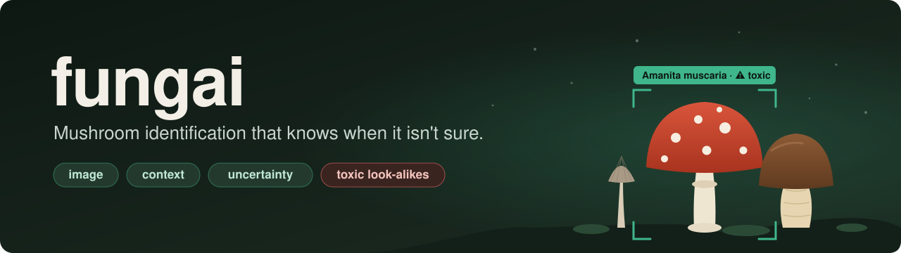

<p align="center">
  
</p>

<p align="center">
  
  
  
  
  
</p>

## Overview

fungai is a personal research project on identifying mushrooms from photos. It is built on the
[FungiTastic](https://arxiv.org/abs/2408.13632) dataset (expert-verified records from the Atlas of Danish Fungi).

The project explores three ideas:

- **Context, not just pixels.** Combine photos with location, season, habitat and substrate, as a mycologist would.
- **Calibrated uncertainty.** Say "I'm not sure" when that's the honest answer.
- **Toxic mistakes count more.** Track confusions between toxic and edible look-alikes separately.

It is structured around two questions:

1. **Q1:** With perfect context, how much better does identification get?
2. **Q2:** Can that context be recovered from the photos themselves?

Results are measured against published FungiTastic baselines and a public
[chatbot benchmark](https://quesma.com/blog/mushroom-llm-vision/) built from the same data. Recent field tests
([Kuznetsov et al. 2026](https://pmc.ncbi.nlm.nih.gov/articles/PMC13065802/)) show current apps struggle
with immature specimens and toxic look-alikes.

## Roadmap

<p align="center">
  
</p>

- **Data:** ingestion, validation and exploratory analysis
- **Training infrastructure:** evaluation, experiment tracking and memory safety
- **Research:** answer Q1 and Q2
- **Improvements:** stronger models, uncertainty and toxic look-alike warnings
- **Scale & ship:** full dataset, benchmarks and a demo

## Quickstart

```bash
uv sync --extra dev
uv run python -m fungai.data.ingest --subset mini --size 300 --extras metadata masks
uv run --extra dev python -m pytest tests/
uv run python -m fungai.model.train --config configs/default.yaml
uv run mlflow ui --backend-store-uri sqlite:///mlflow.db --port 5000
```

---

<p align="center"><sub>Personal research project. Never eat a wild mushroom on the strength of an app, this one included.</sub></p>
